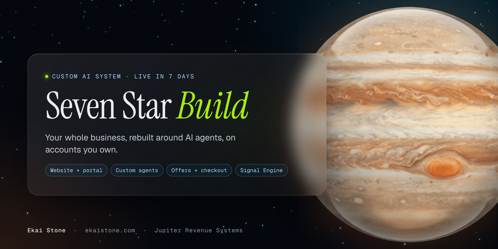

<h1 align="center">The Seven Star Build</h1>

<b>Your whole business, rebuilt around AI agents, on accounts you own.</b>

  
  
  

---

A custom AI system, built by my AI agents for your business: your site, your client portal, agents that run your delivery, your offers and checkout, your email and CRM, your Meta ads with Signal Engine tracking, and the operations that keep it all running. Everything is installed on accounts you own. Live in 7 days.

### Who it's for

- **Telehealth clinics** running paid acquisition into consults
- **Coaches and consultants** selling programs and services
- **Creators** with courses and info products at low, mid and high ticket
- **Agency owners** already doing $50K+ a month who deliver with a team

### What gets built

| | |
|---|---|
| **Your website** | Your world in Framer: programs, products, resources, results, financing, about and blog, with a client login |
| **Your client portal** | A personal portal for every buyer that shows what they own, their next step, and walks them through your delivery |
| **Custom delivery agents** | AI agents built around how you deliver, such as intake and extraction, curriculum, design, slides and voice, and launch kits, delivered to the portal |
| **Offer ladder and checkout** | Low, mid and high ticket offers with order bumps and one time offers. The sale grants access automatically |
| **Email, SMS and CRM** | Buyer bridge, nurture, abandoned cart and follow up sequences in your voice |
| **Meta ads + Signal Engine** | Campaigns, creative and copy, with Pixel and Conversions API on shared event IDs so Meta counts every sale once. [More](https://github.com/jupiter-revenue-systems/signal-engine) |
| **Instagram Sales Agent** | Built on ARIA. Answers, qualifies and routes your leads. [More](https://github.com/jupiter-revenue-systems/instagram-sales-agent) |
| **Operations core** | Support inbox to ticket to fix, quality checks on agent outputs, a handoff queue for your team, and client records in your own database |
| **Training** | Live training calls, a short video for each agent and a written runbook |
| **Settling in** | Fixes and adjustments through day 30 after go live |

### How it runs

1. **Start.** Agreement signed, accounts opened in your name, access given.
2. **Blueprint and build.** A 60 minute blueprint call, then my agents build the system.
3. **Test.** Test buyers run every path, fixes go in, you review it in your own portal.
4. **Live.** Your site and system go live on your accounts, with ads running into it. Live in 7 days.
5. **Training and settling in.** Training calls, videos and runbook, with fixes through day 30.

### Investment

- **The Seven Star Build**: from $15,000. Pay in full and save 20%, or 3 monthly payments. [Explore the Build](https://ekaistone.com/seven-star/build)
- **The Seven Star License**: for operators who deliver with a team, $25,000 to $50,000. [Explore the License](https://ekaistone.com/seven-star/license)

> **Private repository.** Every build is custom and private to the client. Your work product is yours on full payment, and your accounts, data and CRM stay in your name. Jupiter keeps its frameworks, agents and the Signal Engine that run inside your build. [Book a Discovery Call ($150)](https://ekaistone.com/book/discovery) or [apply](https://ekaistone.com/seven-star/apply).

---

Built by <a href="https://github.com/ekaionjupiter">Ekai Stone</a> · <a href="https://ekaistone.com">ekaistone.com</a> · Jupiter Revenue Systems

